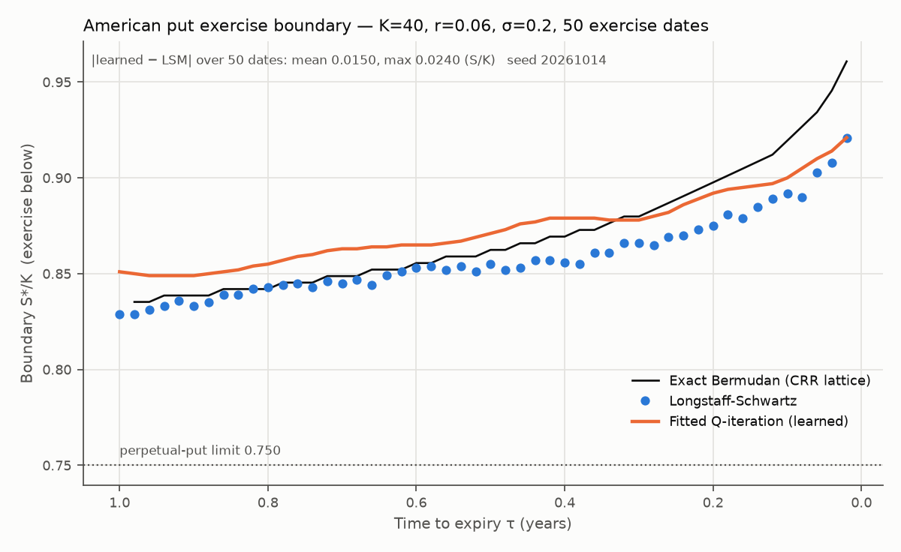
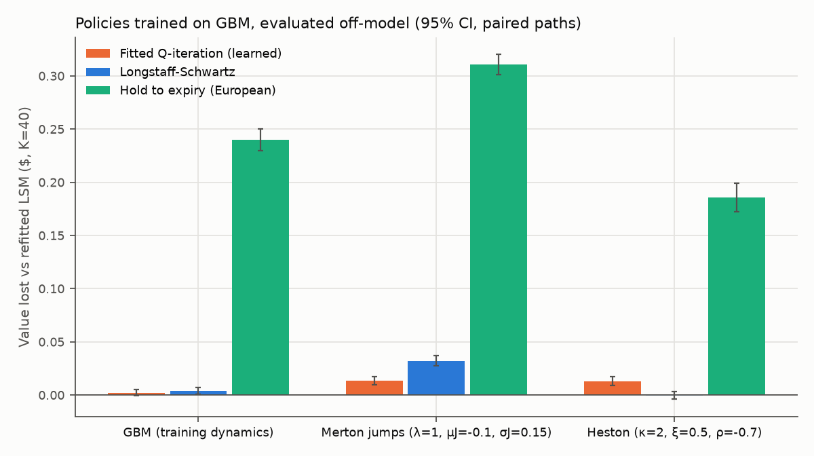
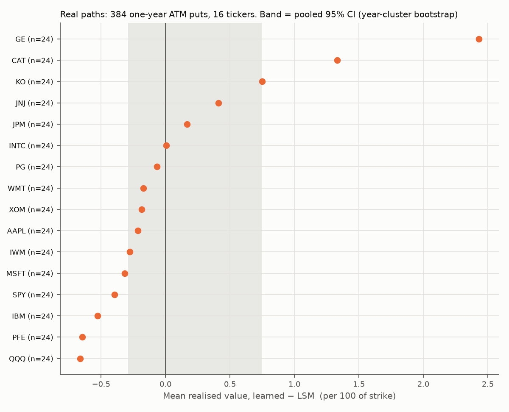

# Learned Optimal Stopping for American Options

An RL agent decides, at each exercise date, whether to exercise an American put or hold it.
The classical answer is computable: Longstaff-Schwartz finds the exercise boundary by
backward induction, and in limiting cases there are closed forms. **The deliverable is not
a better policy. It is a learned policy checked against a known-correct answer, followed by
an honest measurement of what happens when the world stops matching its training
assumptions.**

## Why this project exists

Most reinforcement-learning results in finance cannot be checked, because nobody knows the
right answer. Optimal stopping is different. The classical solution is computable, and in
limiting cases it is exact. That makes it the rare setting where you can prove a learned
policy is correct before asking it anything hard. This project does that first. Then it
measures what actually matters: how fast the verified policy stops being correct once the
world stops matching the model it was trained on.



## Result 1: the learned boundary matches the classical one

On the training distribution (American put, K=40, r=0.06, σ=0.2, T=1, 50 exercise dates),
the learned exercise boundary agrees with Longstaff-Schwartz to within **0.015 S/K on average
and 0.024 at worst** across all 50 dates. Policy values on 200,000 common independent paths
are **2.3107 ± 0.0036 (learned)** and **2.3104 ± 0.0040 (LSM)**. The paired difference is
0.0003, with 95% CI [−0.0038, 0.0044], and the exact Bermudan price is 2.3141.

The exact lattice boundary (black) shows where each method is wrong, and they are wrong in
different places:
- **Long maturities:** the learned boundary sits ~0.015–0.02 above the exact one, so it
  exercises slightly early.
- **Final dates:** both methods fall short of the exact boundary, by up to 0.04.

Values still agree to 0.1%, because the value function is flat near the optimal boundary.
That is also why boundary agreement is the stricter test.

| Spot | Learned (FQI) | LSM | Paired diff, 95% CI | Exact Bermudan |
|---|---|---|---|---|
| 36 | 4.4714 ± 0.0042 | 4.4757 ± 0.0043 | −0.0044 [−0.0100, 0.0013] | 4.4779 |
| 40 | 2.3119 ± 0.0036 | 2.3089 ± 0.0040 | +0.0030 [−0.0011, 0.0072] | 2.3141 |
| 44 | 1.1044 ± 0.0038 | 1.1027 ± 0.0041 | +0.0017 [−0.0010, 0.0044] | 1.1099 |

## Result 2: under misspecification, neither method uniformly degrades less



Both policies are trained on GBM, then evaluated on dynamics they never saw: Merton
jump-diffusion and Heston stochastic volatility, each with total variance matched to σ=0.2,
so only the *shape* of returns changes. Regret is the value lost against LSM refitted on the
true dynamics. Units are $ on a put worth ≈ $2.2–2.3; 200,000 paired paths; 95% CI.

| Dynamics | Learned regret | LSM (GBM-fit) regret | Learned − LSM value |
|---|---|---|---|
| GBM (training) | 0.0022 [−0.0007, 0.0052] | 0.0040 [0.0009, 0.0072] | +0.0018 [−0.0023, 0.0059] |
| Merton jumps | 0.0136 [0.0098, 0.0174] | 0.0323 [0.0274, 0.0372] | **+0.0187 [0.0155, 0.0218]** |
| Heston | 0.0130 [0.0089, 0.0170] | −0.0005 [−0.0039, 0.0030] | **−0.0134 [−0.0176, −0.0093]** |

The two methods break in opposite places:
- **Under jumps,** the learned policy loses less than half what GBM-fitted LSM loses.
- **Under stochastic volatility,** it is the one that degrades, while LSM loses nothing
  measurable.

Both differences are statistically clear, and both are small: under 1.5% of option value in
every case. Against the cost of ignoring early exercise entirely (hold to expiry, 0.19–0.31),
both are robust. The honest conclusion is that the learned policy is **not** uniformly more or
less robust than the classical one. Its misspecification error is different, not smaller.

## Result 3: on real prices, the two are indistinguishable



Real data was downloaded only after Gates A–D passed. The test set:
- 16 tickers, 2001–2025, 384 non-overlapping one-year at-the-money puts
- vol calibrated on the trailing 252 days, with no look-ahead
- in each window, policies trained on GBM at the nearest vol

| Per 100 of strike, pooled (year-cluster bootstrap 95% CI) | Mean |
|---|---|
| Learned − LSM, paired | **+0.10 [−0.29, 0.74]** |
| Learned / LSM / hold-to-expiry realised value | 6.13 / 6.03 / 5.08 |
| Share of perfect-foresight payoff captured: learned / LSM / hold | 0.46 / 0.46 / 0.38 |

The two policies stop on the **same date in 85% of windows**, and the pooled difference is
not distinguishable from zero. Per-ticker means (figure) look spread out, from −0.7 to +2.4,
but each rests on 24 windows and is driven by the few where the policies disagree. Read the
pooled band, not the dots.

## How the agent got through its sanity gate

Five gates were written in [`GATES.md`](GATES.md) before anything ran. All passed, but not on
the first try, and the record is kept:

| Gate | What it checks | Result |
|---|---|---|
| A | Simulator: MC European prices vs Black-Scholes (20 cases), Merton series (3), Heston martingale | PASS: worst \|z\| 2.24 / 1.44 / 1.60, limit 3.5 |
| B | LSM vs Longstaff & Schwartz (2001) Table 1, all 20 cases | PASS: mean error 0.0057, max 0.0282 (limits 0.02 / 0.04) |
| C | Agent trained on a no-dividend **call** never exercises early | **failed twice**, then PASS: 0 early exercises in 100,000 paths |
| D | Learned put boundary agrees with LSM | PASS on its single run |
| E | Real data sealed until A–D pass | enforced in code |

**What Gate C caught.** The first agent priced the call correctly but made the wrong
*decision* on 0.67% of paths: it exercised deep in the money in the last few dates. There,
holding beats exercising by only K(1 − e^{−rτ}) ≈ 0.0012 per unit strike. The plain Gaussian
features decay to zero past the outermost centre, so the fit could not represent that margin
at the edge of the data.
- **Martingale control variates** reduced the error to 0.50%, still a fail.
- **A third attempt** made it worse (44%) and was reverted.
- **The fix,** written down before it was run: normalised (partition-of-unity) RBFs spanning
  the full data range, which extrapolate flat instead of to zero. This took early exercise
  to exactly zero.

Gate D was then run once on that agent, unchanged.

## Two methods, one fixed point

Longstaff-Schwartz (LSM) is structurally **fitted Q-iteration with a linear approximator**.
It runs one regression per exercise date, fitted on in-the-money paths, and propagates
realised cash flows backwards. The learned agent (`agent/fitted_q.py`) solves the same Bellman
equation, Q_hold(s) = E[γ · max(payoff(s′), Q_hold(s′))], by a different route:

- **one** approximator over the whole (S/K, τ) plane, shared across time
- fitted on all visited states
- bootstrapping from its own value estimate, Q-learning style

So the comparison is not "my model beat theirs". It asks whether two methods agree on the
same fixed point. That is a stronger and more honest claim, and it is checked against an
exact third reference: a CRR lattice with exercise restricted to the same dates.

## Design

- **State:** (S/K, τ). It is 2-D so the exercise boundary can be plotted directly.
- **Reward:** the discounted payoff on exercise, zero otherwise. No shaping.
- **Training:** synthetic GBM only. Fitting paths for the boundary experiment start from
  dispersed spots, S0/K ~ U[0.7, 1.3]. With a single S0, the boundary at early dates lies
  outside every path, and both methods' "boundaries" there are extrapolations (see the
  `GATES.md` changes log).
- **Misspecification:** policies are trained on GBM and evaluated on Merton
  jump-diffusion and Heston, each with total variance matched to the training vol. Regret is
  measured against LSM *refitted on the true dynamics*. The finding to report is how much the
  learned policy degrades **relative to** how much GBM-fitted LSM degrades.
- **Real data:** one-year ATM puts on 16 tickers, 2000–2025, in
  non-overlapping windows. Vol is calibrated on the trailing 252 days with no look-ahead.
  Each window uses policies trained on GBM at the nearest vol. Results are reported as a
  distribution with a calendar-year cluster bootstrap, never as one P&L number. Real paths are
  never trained on, and real option prices are never used.

## Run it

```bash
uv venv .venv && uv pip install --python .venv/bin/python -e '.[dev]'
.venv/bin/optstop baseline     # Gates A, B             (~30 s)
.venv/bin/optstop train        # Gate C; trains put policies
.venv/bin/optstop boundary     # Gate D + figures/boundary.png
.venv/bin/optstop evaluate     # synthetic, misspecification, real (Gate E)   (~4 min)
.venv/bin/pytest -q            # 48 tests, including every validation gate
```

Everything is config-driven (`configs/config.yaml`) and seeded. Each stage writes
`results/metrics.json` and `results/gates.json`, and every figure is drawn from
`metrics.json`.

## Layout

```
src/optstop/
  paths.py            GBM (exact), Merton (exact on grid), Heston (Euler), calibration
  contracts.py        payoffs, exercise schedule, discounting conventions
  baselines/          lsm.py, analytic.py (BS, Merton, perpetual put), lattice.py, benchmarks.py
  env.py              Gymnasium env: one episode = one option lifetime
  agent/fitted_q.py   fitted Q-iteration (normalised-RBF linear, optional extra-trees)
  boundary.py         boundary extraction from any policy
  evaluate/           synthetic.py, real.py, distribution.py
  gates.py            gate records; require_gates() enforces the build order
  pipeline.py, cli.py, figures.py
tests/                one test file per validation claim
```

## Limitations

- **The learned boundary is biased.** It sits ~0.015–0.02 S/K above the exact boundary at long
  maturities, and both methods sit below it near expiry. Gate D's tolerance allows this, and
  it is reported rather than tuned away.
- **The agent needed four attempts to pass Gate C.** The passing design was pre-registered,
  but it was still chosen after seeing failures. A fresh sanity case, such as a put with
  r = 0 (where early exercise is also never optimal), would be a cleaner out-of-sample check.
- **Misspecification is tested at one parameter setting per model.** The sign of the
  learned-vs-LSM gap flips between Merton and Heston, so it may also depend on parameters.
  A sweep is the natural next experiment.
- **Bermudan, not American:** 50 exercise dates per year. Gate B's tolerance absorbs this bias
  (about 0.01).
- **Heston uses an Euler scheme,** so it carries discretisation bias. It is used only as an
  off-model stress test, never as a reference price.
- **Real windows are correlated** across tickers through shared market shocks. The bootstrap
  clusters by calendar year; the effective sample is far below 384.
- **Real paths simplify rates and dividends:** a flat 3% rate, and the policy ignores
  dividends even though the price series is not dividend-adjusted. Realised values are under
  the real-world measure, so they are compared only in pairs, never read as prices.
